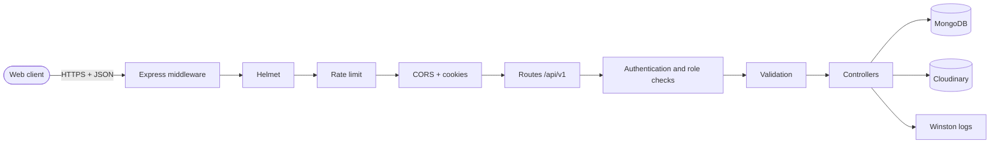
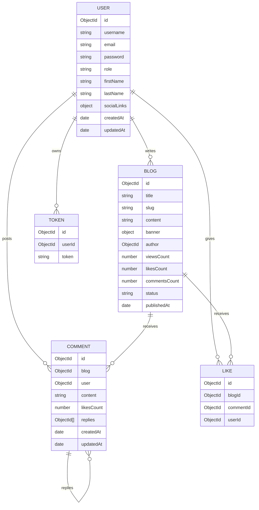

<div align="center">

<h3>Columnly API</h3>

<p>The REST backend for <a href="https://github.com/RexSixT9/columnly-frontend">Columnly</a> — a full-stack<br>
blogging platform with articles, comments, likes, media uploads and moderation.</p>

[](https://expressjs.com)
[](https://www.typescriptlang.org)
[](https://nodejs.org)
[](https://mongoosejs.com)
[](https://jwt.io)
[](https://cloudinary.com)
[](LICENSE)
[](#contributing)

</div>

## Table of contents

- [Overview](#overview)
- [Features](#features)
- [Tech stack](#tech-stack)
- [Project structure](#project-structure)
- [Getting started](#getting-started)
- [Environment variables](#environment-variables)
- [API conventions](#api-conventions)
- [Endpoints](#endpoints)
- [Data models](#data-models)
- [Request examples](#request-examples)
- [Available scripts](#available-scripts)
- [Deployment](#deployment)
- [Contributing](#contributing)
- [License](#license)

## Overview

This service exposes a versioned JSON API at `/api/v1` for the Columnly frontend. It
handles authentication, user profiles, blog articles and their banners, comments and
likes, with MongoDB as the data store and Cloudinary for image hosting.



Request lifecycle:

1. **CORS** validates the origin and allows credentials.
2. **Body and cookie parsers** read JSON, URL-encoded forms and the refresh cookie.
3. **Compression and Helmet** shrink responses and set secure headers.
4. **Rate limiting** protects the API from abuse.
5. **Authentication and authorization** verify the access token and role.
6. **Validation** checks params, query strings and bodies before the controller runs.
7. **Controllers** read or write MongoDB, and upload banners to Cloudinary when needed.

## Features

- JWT access tokens with refresh tokens stored in `httpOnly`, `sameSite: strict` cookies
- Refresh-token persistence and revocation in MongoDB
- Password hashing with bcrypt (cost factor 12)
- Role-based access control for `user` and `admin`
- Admin registration restricted by an email allow-list
- Full blog CRUD with unique, URI-safe slugs
- Cloudinary banner uploads with a 2 MB limit and image replacement on update
- HTML sanitization for article and comment content using DOMPurify
- Comment creation, listing and deletion with per-blog comment counts
- Blog likes and unlikes with duplicate protection
- Pagination with `limit` and `offset`
- Input validation with Zod and express-validator
- Structured logging with Winston and environment-based log levels
- Graceful shutdown on `SIGINT` and `SIGTERM`

## Tech stack

| Area | Technology |
| --- | --- |
| Runtime | Node.js, TypeScript (CommonJS output) |
| Framework | Express 5 |
| Database | MongoDB, Mongoose 9 |
| Auth | jsonwebtoken, bcrypt, cookie-parser |
| Validation | Zod, express-validator |
| Uploads | Multer, Cloudinary |
| Security | Helmet, CORS, express-rate-limit |
| Performance | compression |
| Logging | Winston |
| Dev tooling | nodemon, ts-node, tsc-alias, Prettier, PM2 |

## Project structure

```text
columnly-api/
├── src/
│   ├── config/
│   │   └── index.ts             # Environment configuration
│   ├── controllers/
│   │   └── v1/
│   │       ├── auth/            # register, login, refresh-token, logout
│   │       ├── blog/            # create, read, update, delete, by user, by slug
│   │       ├── comments/        # create, list, list by blog, delete
│   │       ├── like/            # like and unlike a blog
│   │       └── user/            # current user, profile update, admin user management
│   ├── lib/
│   │   ├── cloudinary.ts        # Upload helper
│   │   ├── jwt.ts               # Token signing and verification
│   │   ├── mongoose.ts          # Database connection and shutdown
│   │   ├── rate_limit.ts        # Express rate limiter
│   │   └── winston.ts           # Logger
│   ├── middlewares/
│   │   ├── authenticate.ts      # Bearer token verification
│   │   ├── authorize.ts         # Role checks
│   │   ├── uploadBlogBanner.ts  # Multer buffer to Cloudinary
│   │   ├── validationError.ts
│   │   └── validationErrorHandler.ts
│   ├── models/
│   │   ├── user.ts
│   │   ├── blog.ts
│   │   ├── comment.ts
│   │   ├── like.ts
│   │   └── tokens.ts
│   ├── routes/
│   │   └── v1/
│   │       ├── index.ts         # Mounts all v1 routers
│   │       ├── auth.ts
│   │       ├── blog.ts
│   │       ├── comments.ts
│   │       ├── like.ts
│   │       └── user.ts
│   ├── types/
│   │   └── express.d.ts         # Adds `req.userId`
│   ├── utils/
│   │   └── index.ts             # genSlug and genUsername
│   ├── validators/
│   │   ├── auth.ts
│   │   ├── blog.ts
│   │   ├── comment.ts
│   │   └── user.ts
│   └── server.ts                # App bootstrap
├── dist/                        # Compiled output (generated)
├── nodemon.json
├── tsconfig.json
└── package.json
```

## Getting started

### Prerequisites

- **Node.js 20 LTS** or newer and npm
- **MongoDB** — local or [MongoDB Atlas](https://www.mongodb.com/atlas)
- **Cloudinary** account with cloud name, API key and API secret
- Optional: `pm2` for production process management

### 1. Install

```bash
git clone https://github.com/RexSixT9/columnly-api.git
cd columnly-api
npm install
```

### 2. Configure

```bash
cp .env.example .env      # Windows: Copy-Item .env.example .env
```

Generate strong JWT secrets, for example:

```bash
node -e "console.log(require('crypto').randomBytes(64).toString('hex'))"
```

Use a different secret for `JWT_ACCESS_SECRET` and `JWT_REFRESH_SECRET`.

### 3. Run

```bash
npm run dev
```

The server starts on `http://localhost:3000` (or the `PORT` you configured) after the
MongoDB connection succeeds. Verify it:

```bash
curl http://localhost:3000/api/v1
```

```json
{
  "message": "Welcome to the API!",
  "status": "OK",
  "version": "1.0.0",
  "timestamp": "2026-01-01T00:00:00.000Z"
}
```

### 4. Create an admin

1. Add your email to `WHITELIST_ADMINS` in `.env` (comma-separated for several admins).
2. Restart the API.
3. Register with `role: "admin"` using that email.

Any admin registration attempt from a non-whitelisted email is rejected with `403`.

### 5. Connect the frontend

Run the [Columnly web client](https://github.com/RexSixT9/columnly-frontend) and point
`VITE_API_BASE_URL` at `http://localhost:3000/api/v1`.

## Environment variables

| Variable | Required | Default | Description |
| --- | :---: | --- | --- |
| `PORT` | No | `3000` | Port the HTTP server listens on. |
| `NODE_ENV` | **Yes** | — | `development`, `production` or `test`. |
| `WHITE_LISTED_ORIGINS` | No | — | Reserved for CORS origins; the active allow-list is in `src/config/index.ts`. |
| `MONGO_URI` | **Yes** | — | MongoDB connection string. |
| `LOG_LEVEL` | No | `info` | Winston log level. |
| `JWT_ACCESS_SECRET` | **Yes** | — | Secret for signing access tokens. |
| `JWT_REFRESH_SECRET` | **Yes** | — | Secret for signing refresh tokens. |
| `ACCESS_TOKEN_EXPIRATION` | No | — | Access-token lifetime, e.g. `1h`. |
| `REFRESH_TOKEN_EXPIRATION` | No | — | Refresh-token lifetime, e.g. `7d`. |
| `WHITELIST_ADMINS` | No | empty | Emails allowed to register as admin. |
| `CLOUDINARY_CLOUD_NAME` | **Yes** | — | Cloudinary cloud name. |
| `CLOUDINARY_API_KEY` | **Yes** | — | Cloudinary API key. |
| `CLOUDINARY_API_SECRET` | **Yes** | — | Cloudinary API secret. |

> **CORS note:** the allow-list used by the server is currently defined in
> `src/config/index.ts`. Add your deployed frontend origin there before shipping to
> production.

## API conventions

**Base URL**

```text
http://localhost:3000/api/v1
```

**Authentication**

Send the access token on protected routes:

```http
Authorization: Bearer <accessToken>
```

The refresh token lives in an `httpOnly` cookie and is sent automatically when the client
uses `withCredentials: true`. Access tokens expire quickly; call `/auth/refresh-token` to
obtain a new one.

**Success responses** usually include a machine-readable `code` and a human-readable
`message`:

```json
{
  "code": "BlogCreated",
  "message": "Blog created successfully",
  "blog": { "...": "..." }
}
```

**Error responses** follow the same shape:

```json
{
  "code": "AuthenticationError",
  "message": "Access token has expired"
}
```

| Status | Meaning |
| --- | --- |
| `200` | Success |
| `201` | Resource created |
| `204` | Success with no body (logout) |
| `400` | Invalid input or duplicate action (for example, already liked) |
| `401` | Missing, invalid or expired token |
| `403` | Authenticated but not allowed |
| `404` | Resource not found |
| `409` | Conflict (email or username already exists) |
| `413` | Uploaded file too large |
| `429` | Rate limit exceeded |
| `500` | Unexpected server error |

**Pagination**

List endpoints accept `limit` (1–50) and `offset` (0 or greater). Responses include
`limit`, `offset` and `total` alongside the collection.

## Endpoints

### Service

| Method | Endpoint | Access | Description |
| --- | --- | --- | --- |
| `GET` | `/` | Public | Health/version response |

### Auth — `/auth`

| Method | Endpoint | Access | Description |
| --- | --- | --- | --- |
| `POST` | `/auth/register` | Public | Register a user or a whitelisted admin |
| `POST` | `/auth/login` | Public | Sign in and receive an access token |
| `POST` | `/auth/refresh-token` | Refresh cookie | Get a new access token |
| `POST` | `/auth/logout` | Authenticated | Delete the refresh token and clear the cookie |

### Users — `/users`

| Method | Endpoint | Access | Description |
| --- | --- | --- | --- |
| `GET` | `/users/current` | User or admin | Get the signed-in profile |
| `PUT` | `/users/current` | User or admin | Update profile, password and social links |
| `DELETE` | `/users/current` | User or admin | Delete the signed-in account |
| `GET` | `/users` | Admin | List all users |
| `GET` | `/users/:userId` | Admin | Get one user |
| `DELETE` | `/users/:userId` | Admin | Delete a user |

`PUT /users/current` accepts any of: `username`, `email`, `password`, `first_name`,
`last_name`, `website`, `facebook`, `instagram`, `x`, `youtube`. Every field is optional;
omitted fields keep their current value, and email and username must stay unique.

### Blogs — `/blogs`

| Method | Endpoint | Access | Description |
| --- | --- | --- | --- |
| `GET` | `/blogs?limit=9&offset=0` | Public | Paginated article list |
| `GET` | `/blogs/:slug` | Public | Get an article by slug |
| `GET` | `/blogs/user/:userId` | User or admin | Articles written by a user |
| `POST` | `/blogs` | Admin | Create an article |
| `PUT` | `/blogs/:slug` | Admin | Update an article |
| `DELETE` | `/blogs/:blogId` | Admin | Delete an article |

`POST /blogs` and `PUT /blogs/:slug` use `multipart/form-data`:

| Field | Type | Required on create | Description |
| --- | --- | --- | --- |
| `banner_image` | File | **Yes** | JPG/PNG banner, maximum 2 MB |
| `title` | Text | **Yes** | Up to 180 characters; the slug is generated from it |
| `content` | Text | **Yes** | Rich text/HTML; sanitized before storage |
| `status` | Text | No | `draft` (default) or `published` |

On update, every field except `banner_image` is optional; omit the file to keep the
existing banner.

### Likes — `/likes`

| Method | Endpoint | Access | Description |
| --- | --- | --- | --- |
| `POST` | `/likes/blog/:blogId` | User or admin | Like a blog |
| `DELETE` | `/likes/blog/:blogId` | User or admin | Remove your like |

A second like from the same user returns `400` with `code: "AlreadyLiked"`.

### Comments — `/comments`

| Method | Endpoint | Access | Description |
| --- | --- | --- | --- |
| `POST` | `/comments/blog/:blogId` | User or admin | Add a comment |
| `GET` | `/comments/blog/:slug` | Public | List comments for an article |
| `GET` | `/comments` | Admin | List all comments |
| `DELETE` | `/comments/:commentId` | User or admin | Delete a comment |

Comment content is sanitized with DOMPurify and limited to 1,000 characters.

## Data models



**Model notes**

- `User.password` is hashed in a `pre('save')` hook and excluded from queries by default
  (`select: false`). `role` is immutable after creation.
- `Blog.slug` is generated from the title with a six-character suffix for uniqueness.
  `banner` stores the Cloudinary `publicId`, `url`, `width` and `height`.
- `Blog` timestamps map `createdAt` to `publishedAt`.
- `Like` supports either a `blogId` or a `commentId`, with a required `userId`.
- `Token` stores issued refresh tokens so they can be revoked on logout.

## Request examples

### Register

```bash
curl -X POST http://localhost:3000/api/v1/auth/register \
  -H "Content-Type: application/json" \
  -d '{
    "email": "writer@example.com",
    "password": "correct-horse-battery",
    "role": "user"
  }'
```

### Login

```bash
curl -X POST http://localhost:3000/api/v1/auth/login \
  -H "Content-Type: application/json" \
  -c cookies.txt \
  -d '{
    "email": "writer@example.com",
    "password": "correct-horse-battery"
  }'
```

Keep the returned `accessToken`; the refresh token is stored in `cookies.txt`.

### Create a blog

```bash
curl -X POST http://localhost:3000/api/v1/blogs \
  -H "Authorization: Bearer $ACCESS_TOKEN" \
  -F "title=Designing for calm" \
  --form-string "content=<p>Good interfaces leave room to think.</p>" \
  -F "status=published" \
  -F "banner_image=@./cover.jpg"
```

### Read blogs

```bash
curl "http://localhost:3000/api/v1/blogs?limit=6&offset=0"
```

### Refresh an access token

```bash
curl -X POST http://localhost:3000/api/v1/auth/refresh-token \
  -b cookies.txt
```

## Available scripts

| Command | Description |
| --- | --- |
| `npm run dev` | Start with nodemon and ts-node |
| `npm run build` | Compile TypeScript and rewrite `@/` aliases with `tsc-alias` |
| `npm start` | Run the compiled server from `dist/server.js` |
| `npm run start:prod` | Start with PM2 under the name `columnly-api` |

## Deployment

1. Create a production MongoDB Atlas cluster and a Cloudinary account.
2. Set every variable from `.env.example` with `NODE_ENV=production`.
3. Build and start:
   ```bash
   npm ci
   npm run build
   npm run start:prod
   ```
4. Terminate TLS at a reverse proxy such as Nginx or Caddy and forward to `PORT`.
5. Set the deployed frontend origin in the CORS allow-list in `src/config/index.ts`.
6. Never commit `.env`; inject secrets through your host's environment settings.

> In production the refresh cookie is marked `secure`, so the client and API must be
> served over HTTPS for authentication to work.

## Contributing

1. Fork the repository and create a branch:
   ```bash
   git checkout -b feat/comment-replies
   ```
2. Follow the existing layering: `routes` → `middlewares` → `validators` →
   `controllers` → `models`
3. Keep responses consistent with the existing `{ code, message, ... }` shape.
4. Validate every new input in `src/validators` and sanitize user-generated HTML.
5. Run the build and format your changes:
   ```bash
   npm run build
   npx prettier --write .
   ```
6. Open a pull request that explains the change, the motivation and how you tested it.

Good first contributions include comment replies, tag/category support, article search,
view counting, integration tests and OpenAPI documentation.

Please do not commit `.env` files, uploaded images, `node_modules` or `dist`. For security
issues, use GitHub's private security advisory rather than a public issue.

## License

Released under the [Apache License 2.0](LICENSE).

<div align="center">

Frontend repository: [RexSixT9/columnly-frontend](https://github.com/RexSixT9/columnly-frontend)

</div>
